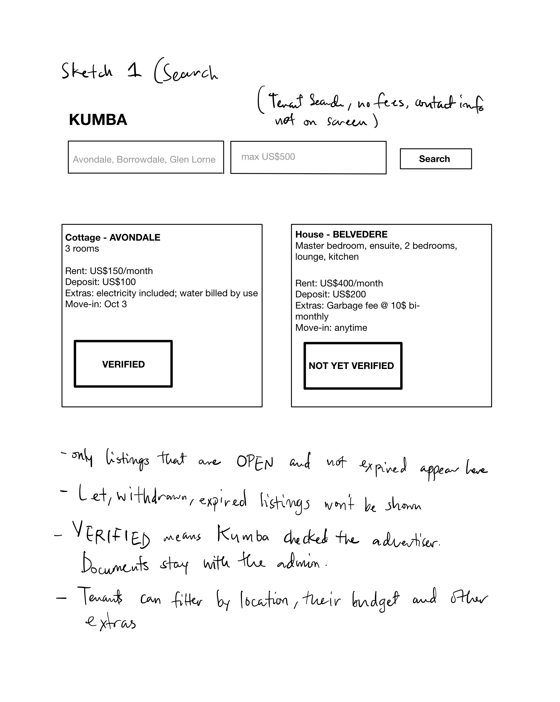
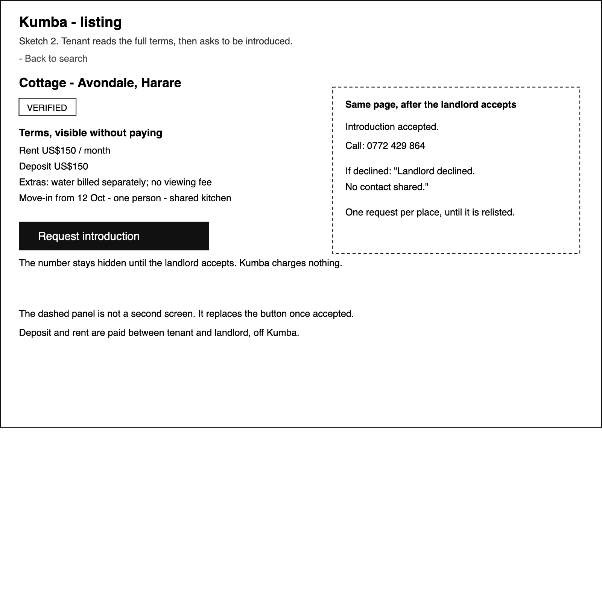
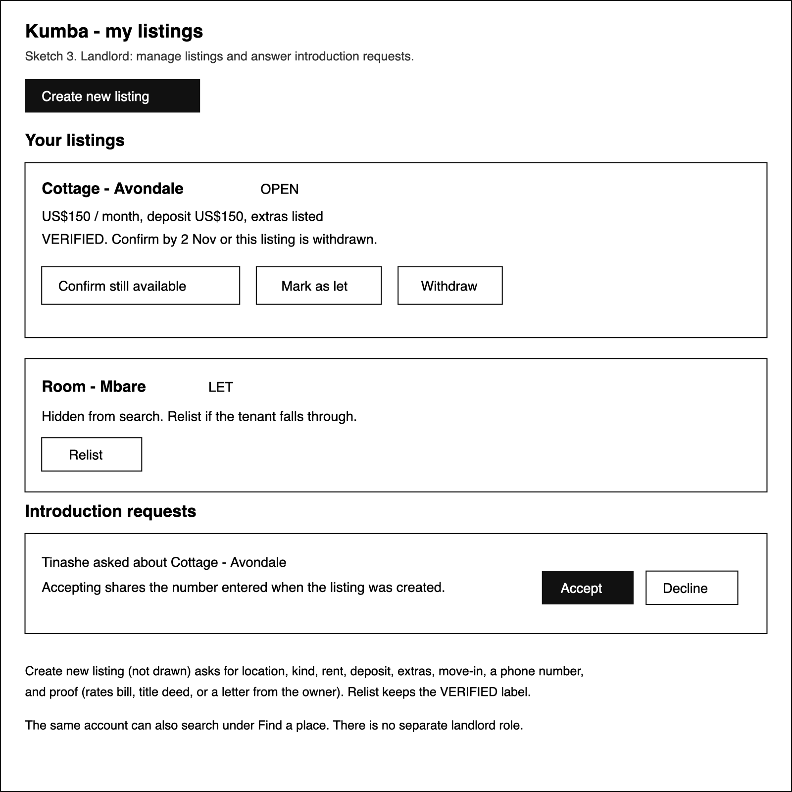
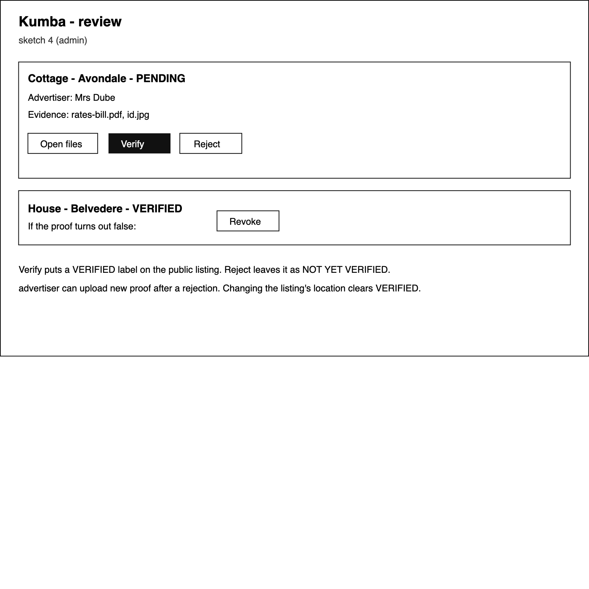

# UI sketches

Low-fidelity and monochrome. Registration, errors, and visual styling are left out. Four screens cover search, an introduction, the landlord's listings, and admin review.

## 1. Tenant search

Every result already shows rent, deposit, extras, move-in, and whether Kumba has verified the advertiser. Contact is not here. Let and expired listings do not appear.

## 2. Listing page

The tenant reads the full terms, then requests an introduction for free. The dashed panel is the same page after the landlord accepts.

## 3. My listings

The landlord confirms a place is still available, marks it let, withdraws it, or relists it without uploading proof again. Introduction requests are answered here.

## 4. Admin review

The admin opens the uploaded proof, then verifies, rejects, or revokes the listing.

