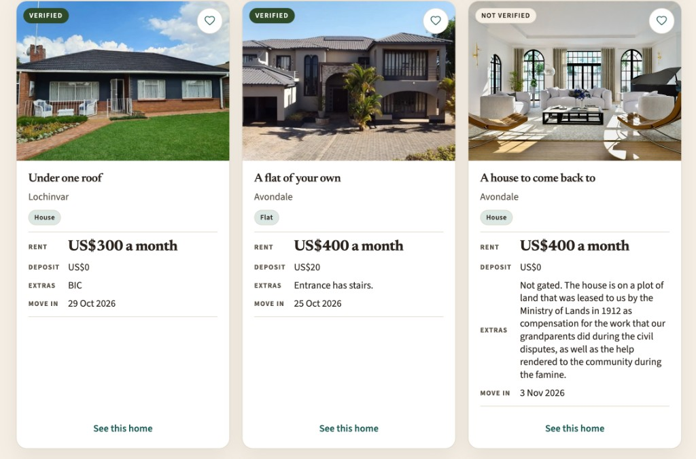

# p5 tasks (user testing)

| Title                       | Instruction                                                                                                                                                                                            | Rationale                                                                                                                                                                                                                                                                                                                                                                                                                                                                                                                                                                                                                                                       |
| --------------------------- | ------------------------------------------------------------------------------------------------------------------------------------------------------------------------------------------------------ | --------------------------------------------------------------------------------------------------------------------------------------------------------------------------------------------------------------------------------------------------------------------------------------------------------------------------------------------------------------------------------------------------------------------------------------------------------------------------------------------------------------------------------------------------------------------------------------------------------------------------------------------------------------- |
| Browsing without account    | You have two weeks left on your lease. Without making an account, look up places you could stay if your budget is US$500 a month.                                                                      | Here we test searching for a listing, and see how the tenant judges a place from the advert, without needing an account. It is worth testing because the whole product fails if they cannot tell the real cost, or if they hit a sign-in wall before they have seen a house. A cognitive walkthrough already knows rent, deposit, and extras are on the card, and that Find your home needs no login, so doing the task ourselves would not fail. What we cannot see is whether someone on a US$500 budget uses deposit and extras, or only the rent filter, or starts looking for a phone number as soon as they land on the page.                             |
| Get an introduction         | You like and want to view a VERIFIED Avondale cottage or flat around US$400. Then get an introduction to the landlord.                                                                                 | This is Introducing from the tenant side, plus the VERIFIED label from Verifying. It is worth testing because the number is supposed to stay off the page until the landlord accepts, and because VERIFIED is what admins at Kumba check, not a document the tenant accesses. A walkthrough already knows to sign up, open the listing, and request an introduction, then wait for the other window to accept. A user may look for a phone on the card, try to message from the landing page, or not notice they need an account. After the landlord accepts, the evaluation gulf is whether they notice the number, sit on PENDING, or think nothing happened. |
| Put a house up              | You have a house in Belvedere that is unoccupied: US$400 rent, US$200 deposit, water billed, no other levy, move-in 15 November, your phone number. Put it up. People should be able to see the rooms. | This is Listing from the advertiser side, including a photo. It is worth testing because My homes is the most dense page, and putting a house up is a long form plus a file, not just a single click. A walkthrough already knows List a place, the listing form, and uploading a photo. A user may not find where to list, may put the phone in the public extras text box, skip the photo, or think the house is up before they have published. That is the testing point of the execution we cannot simulate by doing it ourselves.                                                                                                                          |
| Change your mind            | You listed the wrong extras (and mistakenly included a US$20 security levy). Fix the listing.                                                                                                          | Landlords fix terms after they publish. Edit is worth testing because the wrong levy is exactly the extra charge tenants were supposed to see up front; if they cannot change it, the listing is not truthful. A walkthrough goes to My homes and edits the open house. A user may publish a second listing, withdraw and start over, or not see that this house can still change. If they make a duplicate, search shows two houses and the first one still has the wrong levy.                                                                                                                                                                                |
| Two people asked            | Two people have asked about your house. How to deal with these requests.                                                                                                                               | This is Introducing from the landlord side, with two PENDING requests added after the house is listed. It is worth testing because a walkthrough with one request never hits two people wanting the same number. We already know (from the walkthrough videos) the ACCEPT/DECLINE work if we click them ourselves. What we do not know is whether a user can tell the two people apart, whether they accept both, and whether the popup before sharing the number helps or just gets in the way.                                                                                                                                                                |
| Let, then they fall through | You have agreed with one of them. The house is let. A week later they fall through. You want it seen again.                                                                                            | Mark let is how a place leaves search (unless withdrawn). Relist is how it comes back when the tenant falls through. Both sit on the same card as confirm and withdraw. A walkthrough already knows the order and the warning popups. A user may withdraw instead of let, confirm instead of relist, or type the house in again. Relist should keep the terms and the photo. If they cannot find that path, it means the design could be better, especially for the fall-through case.                                                                                                                                                                          |

## notes

### Jordan

Avondale / Belvedere loc. Asked if real places. thinks Avondale is a street

Max rent 500 and a 400 + 400 deposit house still in the list. treated the box as whole move-in, not just rent

Left area blank, dump of every listing. Typed Harare and Avondale, Harare came back.

"ale" hit Avondale, Borrowdale which are at the end of the names of the neighborhoods

Verified / not verified on the photo. Asked if that means the picture is real. User seemed to skip most of the not-verified ones, thought it was fake and should not be up

likes that stand-in photos look like the actual house when uploading house

Ticked house only and the cottages / flats vanished. Did not realise room, cottage, flat, house are all there if you leave type alone.

Long extras on one card stretch the metadata block. Huge gap, then "See this home" sits at the bottom while the other cards have it tight under move-in. Three cards in a row, heights do not match

Heart on two Avondale places that are both about US$400. Wanted to compare them side by side, not just save each. Like is less useful if you cannot pick between similar ones.

### Lance

Logged in and nothing says you are Lance. Tiny name in the header. Two windows both say Kumba. wants it to feel more personal

List jumped. Thought he misclicked. Search polling every 4s, other window had just published.

did not really care about the like feature

Signed up with a gmail. Invalid request. Thought they had to use phone or email, not a username. Needs 3 to 32 characters, password 8+.

List a place as guest, filled the whole form, then login / signup. Came back and never hit publish. Thought it was already listed.

Opened his own house in find your home and tried to ask for an intro. Error. wanted to know why his listing is in his search. Wants search personalized so his homes won't appear if he is also looking to rent

Put their number in extra charges. Box is huge and says extras so that is where the number went.

Asked about currencies. Us dollars and ZiG in the form, no rate. In Zimbabwe people use an official rate and a black market rate. informal deals use black market rate. Thinks it may need to show a rate that would be acceptable to everyone, or which rate the listing means.

## Report

Tried not to explain the UI unless they were stuck with no next move. I aso tried not to disturb as much as possible

### Jordan

Jordan searched with no account and got a grid of places. Rent, deposit, extras, and VERIFIED were already on the cards. It wasn't exactly intuitive how to use those facts though. He thought max rent was the whole move-in budget because a house with US$400 rent plus a US$400 deposit was returned for US$500 max rent. He could see the numbers but my design binds the box to (recurring) rent only not the total at move-in.

When inputting specific locations, Harare matched Avondale and Harare. When Jordan tried "ale" it matched Avondale and Borrowdale, which both end like that. He also asked if Avondale and Belvedere were real, and thought Avondale was a street. Jordan has never been to Harare, and in my design, these names in the product looked obvious.

Verified sits on the photograph. He wanted to know if it meant the picture was real, then skipped most unverified cards as if they were fake (he also gravitated to places with more than just the display photo on the listing). In the debrief, he liked that stand-in photos look like a real house when you upload, which is nice, but then verified starts looking like a photo check, not a check on the property.

When he ticked House only under "Type", cottages and flats vanished. It was diffcult to realize that leaving type empty keeps all four kinds of properties.

Long extras on the right-hand Avondale house stretch the metadata. See this home drops to the bottom while the neighbours sit tight under move-in. He hearted two Avondale places both around US$400 and expected to compare them side by side. Like turned out to be unhelpful for that.

### Lance

Lance typed in his email to sign up, got invalid request, and said he expected a phone or an email, not just a username. The field however, is clearly labelled username. Apparently other housing sites he knows use an email.

He browsed as a guest, and attempted to List a place, signed in, came back, and did not press Publish. He thought the house was already up because of the sign in step. The form looks finished before you have an account, so login felt like the last step rather than a redirect.

His own house showed up in Find your home. He wanted to ask for an introduction, but couldn't and wanted search not to include his listings if he is also looking to rent. The listing page already says this is your home. He also put his number in extra charges. The box is large and labelled extras, so that is where he put his contact went.

While he scrolled, the list jumped. He thought he had misclicked but it was because in a different window had just published a new listing. Search is designed to refresh every 4 seconds.

After login, only a small header name said he was Lance. He wanted it to feel more personal.

The currencies (US dollars and ZiG, the country uses both)were also a concern because there is no exchange rate displayed. In the country, people use an official rate and a black market rate, and informal deals use the black market one. He preferred a listing that says which rate it means, or a rate both sides would accept. Jordan on the other hand did not question currencies. Lance also did not really care about the like feature.

## Flaws

I'd fix verified first, because Jordan started skipping those listings, which we meant to keep in search (when designing, I meant that unverified just means Kumba hasn't checked it but users might think it means scammers or something else). Login vs publish would be next since Lance thought the house was already up and never hit Publish. The other flaws would not be as consequential.

### 1. Verified sits on the photo

**Physical, Major**

The badge is drawn on the image, so Jordan read it as a check on the picture. He asked if verified meant the photo was real, then skipped most not-verified cards as fake. Unverified listings are searchable, just that the landlord has not confirmed they own the place. Tenants would need to use their discretion.

It is happening because HomePhoto puts the mark on the figure, next to the heart, not next to the advertiser. Stand-in photos looking like real houses made it worse. He did liked that realism when uploading though.

One way to address it would be to move it off the photo, next to kind / location. We keep unverified listings in search.

### 2. Own house is in Find your home

**Conceptual, Minor**

Landlord opened his listing from search and wanted to ask for an introduction, but they couldn'. He wanted to know why his house was in the tenant grid, and thinks search should not show his homes if he is also looking to rent.

Find your home is one list of open places. The same account can advertise and search. The listing page does say “this is your home,”

We can drop the current owner’s listings from `/listings/search,` although this is not a high priority refinement.

### 3. Login feels like publishing

**Conceptual, Major**

When a user fills the form on List a place as a guest, signs in, comes back, and never hits Publish, the temporary information on the form is lost. One user (Lance) thought the house was already up. The form looks finished before there is an account, so the sign-in step is taken like the publish action, even though they are distinct, and frankly mean different things.

It happened because My homes shows the full form to guests, then swaps in Log in / Create an account. After auth, the form still needs to be published.

We can either hide the fields until they are signed in, or keep the draft and publish after login (maybe using a popup as soon as they sign in).

### 4. Max rent is not the money to move in

**Conceptual, Moderate**

Setting max rent to 500$ also shows a place with US$400 rent plus a US$400 deposit. The rent filter text-box is seen as the total move-in amount, inclusive of fees and levies. Filter is binding to monthly rent only.

Reading the card gives more information about what the actual total would be.

In our implementation, we can keep the rent as is, and maybe have another filter that looks at total for first move-in so renters are aware of other charges even before clicking each listing's card.

### 5. Contact goes in extras

**Linguistic, Moderate**

Landlord might put their contact in the Extras textbox, which gives everyone access to it (even guest users), and defeats the purpose of asking for an introduction.

A soulution might be to shrink the extras. We can have a pre-filled form that has common items like levies / water / conditions. Alternatively, we can parse the Extras and flag any potential contact numbers appearing, then prompt the landlord to check again before publishing.